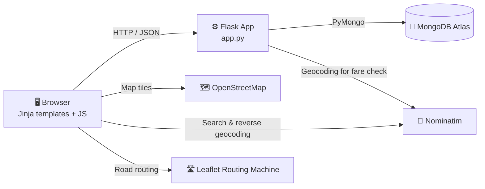
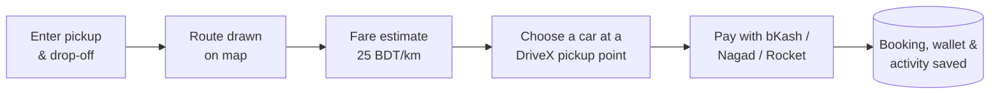

<div align="center">

# 🚗 DriveX

### Ride Booking Platform

Book a car in a few clicks: enter your pickup and drop-off, see the route on an interactive map, compare fares for available cars, and pay with **bKash, Nagad or Rocket**. Built with **Flask** and **MongoDB**, with separate experiences for riders and employees.


<br/>


</div>

---

## ✨ Features

**🗺️ Interactive Route Mapping.**
- Search pickup and drop-off locations with live address suggestions from OpenStreetMap's Nominatim.
- The road route is drawn on a Leaflet map with Leaflet Routing Machine.
- Drag the route's start point and the pickup address updates automatically through reverse geocoding.

**📍 DriveX Pickup Points.** Cars are parked at fixed DriveX pickup points shown as markers on the map. Click a marker to see the cars available at that location.

**💰 Distance-Based Pricing.** Fares are calculated at **25 BDT per km**. The route page shows a live estimate for every car based on the road distance. The server recalculates the distance (geocoding + Haversine formula) before checkout.

**💳 Local Payment Options.**
- Checkout with **bKash, Nagad or Rocket**, plus billing details.
- Each confirmed booking is saved and recorded in the rider's wallet and activity history.

**👤 Rider Dashboard.**
- **Ride:** book a new trip.
- **Wallet:** see payment history and total amount spent.
- **Activity:** see ride history with car, plate number, route, distance, price and booking time.

**🛠️ Employee Dashboard.** Manage the fleet:
- Add cars with VIN, model, capacity, color, plate number, price, image and pickup point.
- Delete cars.
- Search cars instantly with AJAX.
- View all cars with their pickup point names.

**🔐 Role-Based Accounts.**
- Separate registration and login for **users** (driving license + NID), **employees** and **admins**.
- Email addresses are unique across all roles.
- Passwords are hashed with Werkzeug.
- Pages are protected with session-based role checks.

---

## 🏗️ Architecture



### Booking Flow



---

## 🧰 Tech Stack

| Layer | Technologies |
|---|---|
| **Backend** | Python, Flask, Werkzeug (password hashing), Flask sessions |
| **Database** | MongoDB Atlas, PyMongo |
| **Frontend** | Jinja2 templates, HTML5, CSS3, vanilla JavaScript |
| **Maps** | Leaflet, Leaflet Routing Machine, OpenStreetMap tiles, Nominatim geocoding |
| **Other** | `requests`, `python-dotenv` |

---

## 🗄️ Data Model (MongoDB Collections)

| Collection | Key Fields |
|---|---|
| `user` | name, email, license, nid, password (hashed) |
| `employee` | name, email, employee_id, position, nid, password (hashed) |
| `admin` | name, email, admin_id, position, nid, password (hashed) |
| `cars` | carVIN_No, name, model, capacity, color, description, image_url, plate_num, price, pickup_point_id |
| `pickup_points` | name, latitude, longitude |
| `bookings` | user, car, pickup, dropoff, distance_km, price, billing details, payment_method, status |
| `wallet` | user_id, transaction_type, amount, payment_method, booking_id, status |
| `activity` | user_id, activity_type, car, pickup, dropoff, distance_km, price, status |

Unique indexes are created on start-up for emails, employee/admin IDs and car VIN numbers. The default pickup points are seeded automatically if the collection is empty.

---

## 🚀 Getting Started

### Prerequisites

- **Python 3.10+**
- A **MongoDB** database: a free [MongoDB Atlas](https://www.mongodb.com/atlas) cluster or a local MongoDB server

### 1. Clone and set up a virtual environment

```bash
git clone https://github.com/NusratZahanSadia/DriveX.git
cd DriveX

python -m venv .venv
# Windows
.venv\Scripts\activate
# macOS / Linux
source .venv/bin/activate

pip install -r requirements.txt
```

### 2. Configure environment variables

Create a `.env` file in the project root:

```env
SECRET_KEY=your_random_secret_key
MONGODB_URI=mongodb+srv://<username>:<password>@<cluster>.mongodb.net/DriveX?retryWrites=true&w=majority
```

| Variable | Description |
|---|---|
| `SECRET_KEY` | Secret used to sign Flask sessions |
| `MONGODB_URI` | MongoDB connection string |

### 3. Run

```bash
python app.py
```

Open **http://127.0.0.1:5000** 🎉

### 4. Try it out

1. **Sign up as an employee** and add a few cars to the pickup points from the Employee Dashboard. Car images are loaded from `static/image/`, so use a file name from that folder (e.g. `Corolla.jpg`).
2. **Sign up as a user**, enter a pickup and drop-off location, and click **See Price**.
3. Click a **DriveX pickup point** marker, choose a car, and complete the payment.
4. Check your **Wallet** and **Activity** pages for the booking.

---

## 📡 Routes

| Route | Method | Access | Description |
|---|---|---|---|
| `/` | GET | Public | Landing page with ride search |
| `/register` | GET, POST | Public | Register as user, employee or admin |
| `/login` | GET, POST | Public | Role-based login |
| `/logout` | POST | Signed in | End the session |
| `/route` | GET | Public | Map, route and car selection |
| `/select_car` | POST | User | Save the selected car and trip |
| `/payment` | GET, POST | User | Checkout and booking confirmation |
| `/calculate_distance` | POST (JSON) | Public | Geocode locations and return distance & fare |
| `/user_dashboard` | GET | User | Rider dashboard |
| `/wallet` | GET | User | Payment history and total spent |
| `/activity` | GET | User | Ride history |
| `/employee_dashboard` | GET, POST | Employee | Add, delete, search and view cars |
| `/search_car` | POST (JSON) | Public | Search cars by name |
| `/init_db` | GET | Public | Seed default pickup points |

---

## 📁 Project Structure

```
DriveX/
├── app.py                      # Flask app: routes, auth, booking, pricing, MongoDB
├── requirements.txt
├── .env.example
├── templates/
│   ├── home.html               # Landing page with ride search
│   ├── login.html
│   ├── register.html           # User / employee / admin sign-up
│   ├── route.html              # Map, routing, pickup points, car selection
│   ├── payment.html            # Checkout with bKash / Nagad / Rocket
│   ├── user_dashboard.html
│   ├── wallet.html             # Payment history
│   ├── activity.html           # Ride history
│   └── employee_dashboard.html # Fleet management
└── static/
    ├── *.css                   # Page styles
    ├── employee_dashboard.js   # Dashboard navigation & AJAX car search
    └── image/                  # Car photos, payment logos, icons
```

---

## 🗺️ Roadmap

- [ ] Admin dashboard for managing users, employees and bookings
- [ ] Real payment gateway integration (bKash / Nagad / Rocket APIs)
- [ ] Restrict employee and admin sign-up to invited accounts
- [ ] Driver assignment and live ride status
- [ ] Booking cancellation and car availability tracking

---

## 👥 Team

**Nusrat Zahan Sadia**
[](https://github.com/NusratZahanSadia)
[](https://www.linkedin.com/in/nusrat-zahan-18b028413)

**Samiul Alim Shihab**
[](https://github.com/Shamiul-alim)

<div align="center">

⭐ If you like this project, consider giving it a star!

</div>
